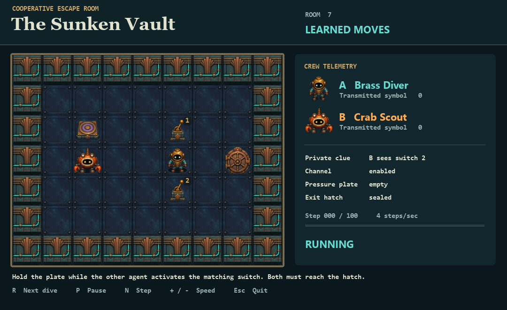

# Cooperative Escape Room

Can two agents learn to solve a puzzle together, and does exchanging a private clue help? This Python project includes the playable room, six automatic controllers, trained checkpoints, and the experiments behind them. **Our clearest communication result:** when agents learned messages and destinations and had a built-in navigator, each of three trained teams escaped in 179/200 trials. Swapping the messages reduced every team to 0/200. Learning individual moves on unfamiliar maps remains open.

**Joining the project?** Start with the [partner handoff](HANDOFF.md) for the decisions, evidence, limitations, and the role-coordination experiment.



## Run your first demo

On Windows, install Python 3.12, open PowerShell, and run:

```powershell
git clone https://github.com/humzahassan1/Cooperative-Escape-Room.git
cd Cooperative-Escape-Room
python -m venv .venv
.\.venv\Scripts\python.exe -m pip install -r requirements.txt
& ".\Watch Learned Cooperation.cmd"
```

The agents start moving automatically. The launchers use the project virtual environment when available. CPU is sufficient. Checkpoints are included under [runs](runs/), and the environment generates its own data. On macOS or Linux, create a Python 3.12 virtual environment, install the same requirements, then run `python demo.py --controller options --checkpoint runs/options/seed7_comm.json` in that environment.

## Choose a demo

| Windows launcher | What you will see |
|---|---|
| Play Demo.cmd | Scripted agents show how to solve a randomized room. |
| Watch Learned Cooperation.cmd | Learned signals and destination choices with built-in pathfinding. Best demo of message dependence. |
| Watch Learned Moves.cmd | A shared evolved policy chooses each move. Either agent can operate either mechanism on the familiar map. |
| Watch Full Map Agents.cmd | The latest PPO pilot sees the full public map and attempts unfamiliar rooms. Expect unsuccessful attempts. |
| Watch Role Coordination.cmd | Shared GRU policy, no assigned jobs. Raw symbols stay unlabeled. After an unlock, the panel names who held the plate and who activated the switch. |
| Watch PPO Agents.cmd | Original independent PPO agents on the fixed room. |
| Watch Staged PPO.cmd | Independent PPO after staged practice and extra training rewards. |
| Play Manual.cmd | Control both agents yourself to inspect the rules. |

One agent sees which numbered switch is correct. One must hold the plate as the other activates that switch, then both must enter the unlocked exit within 100 joint steps. The original room assigns A the plate and B the switches. The learned-moves and full-map versions allow either assignment and vary who sees the clue. The viewer shows the clue to the human observer.

Use **P** to pause, **N** for one automatic step, **R** for the next round, **+/−** for speed, and **Esc** to quit. In manual play, **Tab** selects an agent, **arrows** move, **E** interacts, **Space** waits, and **0/1/2** select a message.

## Reproduce the experiments

Run commands from the repository root with the project environment active. On Windows you can also substitute `.\.venv\Scripts\python.exe` for `python`.

| Experiment | Results, training commands, or entry point |
|---|---|
| Original PPO | [Pilot results](RESULTS.md). Run the two training commands below. |
| Staged PPO | [Staged training and paired clue tests](STAGED.md) |
| Learned goals and messages | [Training, evaluation, and message swaps](LEARNED.md) |
| Learned individual moves | [Training, role swaps, and transfer tests](FREE_ROLES.md) |
| Full-map PPO | Run `python map_ppo.py` to train and evaluate. [Recorded evaluation](runs/map_ppo/evaluation.json) |
| Role coordination | [What was done, and the seed 7 numbers](HANDOFF.md). Finished checkpoints: `runs/role_coordination/seed7_comm` and `seed7_silent`. Watch with `python demo.py --controller roles --checkpoint runs/role_coordination/seed7_comm/checkpoint.pt`. |

```powershell
python -m unittest -v
python learning.py train --out runs/reproduction_comm --seed 7 --steps 500000
python learning.py train --out runs/reproduction_silent --seed 7 --steps 500000 --no-communication
python learning.py evaluate --checkpoint runs/communication/checkpoint.pt --out runs/rechecked.json
python report.py
```

The original trainer rounds up to 501,760 joint steps. The report script recreates the original pilot figure and results from its saved runs. The free-role and full-map training scripts write to fixed paths under `runs/`; use a fresh clone for reruns if you want to retain the published checkpoints locally.

[Environment and rules](environment.py) · [Pygame viewer](demo.py) · [Pinned dependencies](requirements.txt) · [Original tested environment](tested_environment.json) · [PPO attribution](ATTRIBUTION.md)

