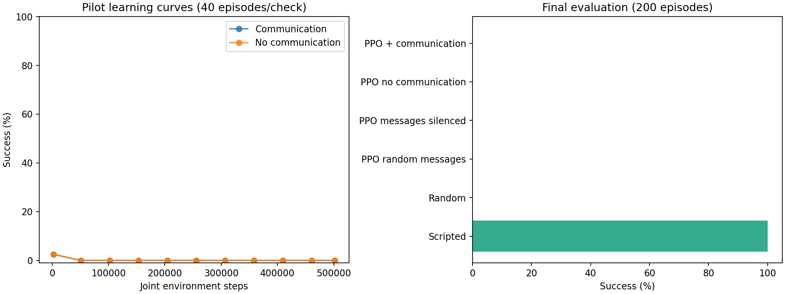

# Pilot results

One training seed (7), fixed room and starts, balanced hidden clue. Each PPO condition trained for 501,760 joint environment steps on CPU. Evaluation uses stochastic actions with learning disabled and seeds 10000–10199. No claim of a reliable communication advantage is supported.

| Controller | Success | Successful steps | Outcomes |
|---|---:|---:|---|
| PPO + communication | 0.0% | N/A | {'timeout': 140, 'wrong switch': 60} |
| PPO no communication | 0.0% | N/A | {'timeout': 198, 'wrong switch': 2} |
| PPO messages silenced | 0.0% | N/A | {'timeout': 140, 'wrong switch': 60} |
| PPO random messages | 0.0% | N/A | {'timeout': 150, 'wrong switch': 50} |
| Random | 0.0% | N/A | {'timeout': 191, 'wrong switch': 9} |
| Scripted | 100.0% | 11.0 | {'success': 200} |

## Interpretation

The scripted agents solve the task, but both final PPO policies fail in this budget. This establishes a working experimental pipeline, not learned cooperation. Sparse coordinated rewards and simultaneous policy learning are plausible difficulties; this pilot does not isolate the cause. Message ablations cannot demonstrate meaningful communication when the original policy already fails.

The full grid is publicly observable except the clue. Movement and timing can also convey information. The scripted reference uses an explicitly programmed symbol convention and is not a learned policy. Fixed layouts, one training seed, memoryless policies, and only two clue values limit generalization.

## Runtime

- PPO + communication: 389.5 seconds (includes periodic and final normal evaluation; excludes message ablations).
- PPO no communication: 415.4 seconds (includes periodic and final normal evaluation; excludes message ablations).

## Next experiment

Preserve this pilot. Test a separately labeled curriculum (unlocking first, then exiting) or potential-based distance shaping with matched rewards across conditions. Repeat across at least three training seeds before making comparative claims. Do not quietly replace these failed results.

